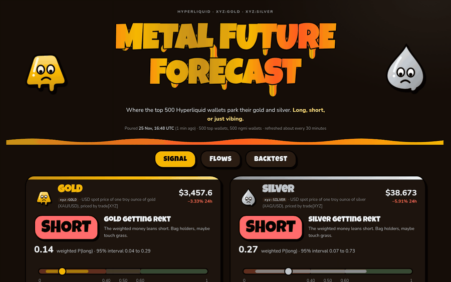
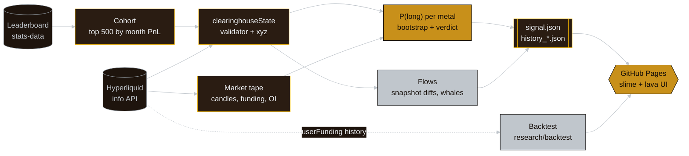
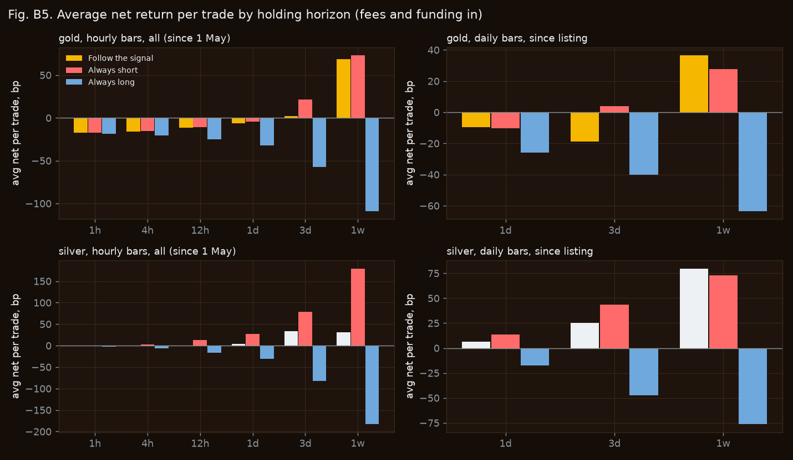
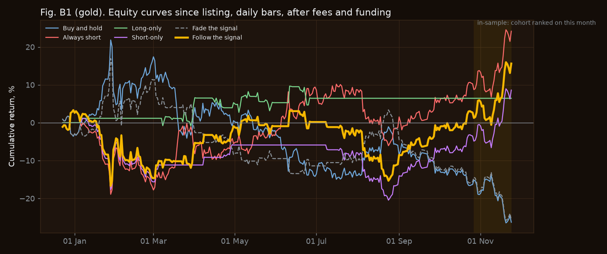
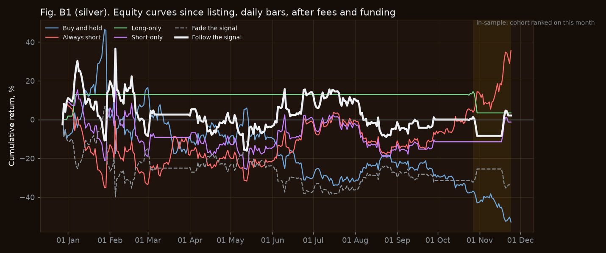

<p align="center">
  <picture>
    <source media="(prefers-color-scheme: dark)" srcset="docs/banner-dark.svg">
    <source media="(prefers-color-scheme: light)" srcset="docs/banner-light.svg">
    
  </picture>
</p>

<h3 align="center">Where the top 500 Hyperliquid wallets park their gold and silver.</h3>
<p align="center">Long, short, or just vibing. One formula, two metals, refreshed every 30 minutes.</p>

<p align="center">
  <a href="https://prafullj0shi.github.io/metal-future-forecast/"></a>
  <a href="#markets"></a>
  <a href="research/backtest"></a>
  <a href="requirements.txt"></a>
  <a href="LICENSE"></a>
</p>

<p align="center">
  <a href="https://prafullj0shi.github.io/metal-future-forecast/"><b>Open the live site</b></a> ·
  <a href="#how-the-call-gets-made">Formula</a> ·
  <a href="#backtest">Backtest</a> ·
  <a href="#pipeline">Pipeline</a> ·
  <a href="docs/ROADMAP.md">v2 roadmap</a>
</p>

<picture>
  <source media="(prefers-color-scheme: dark)" srcset="docs/divider-dark.svg">
  <source media="(prefers-color-scheme: light)" srcset="docs/divider-light.svg">
  
</picture>

<p align="center">
  
</p>

## What it is

A sibling of [hyperliquid-btc-signal](https://github.com/PrafullJ0shi/hyperliquid-btc-signal) pointed at metals. Same cohort, same weights, same thresholds, same pipeline. The only change is the market: instead of BTC, it reads every cohort wallet's position in Hyperliquid's gold and silver perpetuals and turns them into one call per metal.

- **Signal.** Gold and silver side by side: LONG, SHORT or NEUTRAL, the weighted P(long), a 95% bootstrap interval, the biggest bags, recent position changes, a degen meter and the market tape (mark, funding, open interest, EMAs, regime).
- **Flows.** Who opened, added, closed or trimmed in the last 1h to 1w, the top 500 against the ngmi 500 (the month's biggest losers), a whale tape, and liquidations seen in tracked fills.
- **Backtest.** The same call rebuilt from each wallet's position history back to the listing of both markets, with baselines, regimes, a threshold grid and an honest verdict.

The voice on the site is cheeky (gold is cooking, silver got rekt, touch grass). The numbers are not: every chart and table keeps plain labels.

> [!WARNING]
> Not financial advice. This reads public positions; it does not predict prices. Bag holders are not role models.

## Markets

Found by walking `perpDexs`, then `metaAndAssetCtxs` for every dex, on 25 Nov 2026.

| Metal | Market used | Venue | Taker fee | Notes |
| :--- | :--- | :--- | ---: | :--- |
| Gold | `xyz:GOLD` | trade[XYZ] HIP-3 dex `xyz` | 0.09% | Live, 25x max leverage. Not in growth mode. |
| Silver | `xyz:SILVER` | trade[XYZ] HIP-3 dex `xyz` | 0.009% | Live, 25x max leverage, growth-mode fees. |
| Gold (reference) | `PAXG` | validator perp dex | standard | Tokenised gold. Shown as a basis check only; it never votes. |

Hyperliquid's validator dex has no gold or silver perpetual, and the GOLD and SILVER markets on the other builder dexes (flx, vntl, hyna, km, cash, mkts) are delisted. HIP-3 dexes keep a separate margin account, so each wallet's equity is its validator-dex account value plus its `xyz` account value.

<a id="how-the-call-gets-made"></a>
## How the call gets made

1. **Cohort.** Pull the public leaderboard, keep wallets with equity of at least USD 10k, positive month PnL and turnover of at most 100x, re-rank the best 700 on `portfolio.perpMonth`, keep the top 500.
2. **Positions.** Read each wallet's `clearinghouseState` on the validator dex and on `xyz`; note its signed `xyz:GOLD` and `xyz:SILVER` size.
3. **Weights.** Each holder of a metal gets

$$
w_i = \ln\bigl(1 + \max(0,\ \mathrm{PnL}^{\text{month}}_i)\bigr)\cdot \min\Bigl(1,\ \frac{E_i}{100\,000}\Bigr)\cdot \min\Bigl(3,\ \frac{|\text{notional}_i|}{E_i}\Bigr)
$$

4. **Reading.** Per metal,

$$
P(\text{long}) = \frac{\sum_{i \in \text{long}} w_i}{\sum_i w_i}
$$

with a 5,000-draw bootstrap (seed 42) for the 95% interval and a Beta(1+L, 1+S) interval alongside.

5. **Call.** LONG at P(long) of 0.60 or more, SHORT at 0.40 or less, otherwise NEUTRAL. The thresholds come from the BTC project and were not tuned on metals.

**Liquidations.** Hyperliquid has no public, market-wide liquidation feed. The Flows tab shows only liquidations that appear in the fills of tracked wallets, and the open-interest change is labelled as a proxy.

<a id="pipeline"></a>
## Pipeline



A sweep takes a few minutes inside the public limit of 1,200 request weight per minute. The scheduled workflow runs it at :11 and :41 past every hour and commits the snapshot.

<picture>
  <source media="(prefers-color-scheme: dark)" srcset="docs/divider-dark.svg">
  <source media="(prefers-color-scheme: light)" srcset="docs/divider-light.svg">
  
</picture>

<a id="backtest"></a>
## Backtest

<!-- BT -->
The live call, rebuilt day by day from every cohort wallet's `xyz:GOLD` and `xyz:SILVER` positions since the markets listed (via `userFunding`; fills only reach back a few days for busy wallets). Fees and funding included; the last 30 days are in-sample because the cohort was ranked on them.

| Metal | Window | Metal move | Signal | Buy and hold | Always short | Sharpe-like | Max DD | Hit rate |
| :--- | :--- | ---: | ---: | ---: | ---: | ---: | ---: | ---: |
| Gold | Since listing, before ranking month (daily, out-of-sample) | -10.1% | **+2.7%** | -16.3% | +10.3% | 0.25 | -19.4% | 50% |
| Gold | Since listing (daily bars) | -20.4% | **+15.6%** | -26.3% | +24.2% | 0.71 | -19.4% | 51% |
| Gold | Hourly max (all 1h candles) | -23.8% | **+18.3%** | -27.2% | +33.0% | 1.56 | -18.2% | 50% |
| Gold | Last 90 days (hourly) | -23.1% | **+34.8%** | -24.5% | +30.5% | 5.43 | -6.4% | 51% |
| Gold | Last 30 days (hourly, in-sample) | -12.3% | **+13.9%** | -12.9% | +13.9% | 5.99 | -6.4% | 51% |
| Silver | Since listing, before ranking month (daily, out-of-sample) | -31.9% | **+0.2%** | -37.5% | +4.9% | 0.32 | -38.5% | 44% |
| Silver | Since listing (daily bars) | -48.3% | **+2.1%** | -52.8% | +35.6% | 0.34 | -38.5% | 44% |
| Silver | Hourly max (all 1h candles) | -46.0% | **+3.3%** | -48.8% | +72.9% | 0.34 | -24.9% | 49% |
| Silver | Last 90 days (hourly) | -41.1% | **+9.8%** | -42.2% | +65.6% | 1.54 | -10.4% | 49% |
| Silver | Last 30 days (hourly, in-sample) | -25.7% | **+1.9%** | -26.3% | +32.7% | 0.92 | -10.2% | 44% |

**Holding horizons** (hourly bars, 1 May to now, fees and funding in; full table for every window in the write-up):

| Metal | Horizon | Trades | Hit rate | Avg net per trade | Always-short avg net | Total return | Max DD |
| :--- | :--- | ---: | ---: | ---: | ---: | ---: | ---: |
| Gold | 1h | 3851 | 50% | **-17.5 bp** | -17.4 bp | -99.9% | -99.9% |
| Gold | 4h | 962 | 52% | **-15.9 bp** | -15.5 bp | -78.6% | -79.3% |
| Gold | 12h | 320 | 55% | **-11.4 bp** | -10.8 bp | -31.4% | -39.7% |
| Gold | 1d | 159 | 57% | **-6.4 bp** | -4.1 bp | -10.5% | -24.9% |
| Gold | 3d | 53 | 53% | **+2.0 bp** | +21.2 bp | +0.4% | -20.5% |
| Gold | 1w | 21 | 57% | **+68.4 bp** | +73.1 bp | +14.2% | -14.9% |
| Silver | 1h | 3621 | 49% | **-1.6 bp** | -0.6 bp | -46.1% | -51.5% |
| Silver | 4h | 905 | 50% | **-0.9 bp** | +3.2 bp | -11.9% | -30.7% |
| Silver | 12h | 301 | 52% | **+0.6 bp** | +13.0 bp | -2.6% | -26.6% |
| Silver | 1d | 150 | 48% | **+4.2 bp** | +26.8 bp | +2.4% | -25.7% |
| Silver | 3d | 50 | 48% | **+33.9 bp** | +78.5 bp | +12.9% | -23.1% |
| Silver | 1w | 20 | 50% | **+31.4 bp** | +179.6 bp | +3.0% | -24.9% |



Gold, hourly bars: average net per trade is negative at 1h, 4h, 12h, 1d; positive at 3d, 1w; Gold, daily bars: average net per trade is negative at 1d, 3d; positive at 1w. Silver, hourly bars: average net per trade is negative at 1h, 4h; positive at 12h, 1d, 3d, 1w; Silver, daily bars: average net per trade is negative at no horizon; positive at 1d, 3d, 1w.

**Honest take.** **Gold, out-of-sample (23 Dec 2025 to 27 Oct 2026):** the signal made +2.7% (Sharpe-like 0.25, max drawdown -19.4%) while gold moved -10.1%. Buy and hold made -16.3%, always short +10.3%. Against the better baseline (always short) that is -7.6%: no edge over simply picking a side. **Silver, out-of-sample (28 Dec 2025 to 27 Oct 2026):** the signal made +0.2% (Sharpe-like 0.32, max drawdown -38.5%) while silver moved -31.9%. Buy and hold made -37.5%, always short +4.9%. Against the better baseline (always short) that is -4.7%: no edge over simply picking a side. Full write-up with regimes, long-only and short-only legs, the threshold grid and every bias: [research/backtest](research/backtest/README.md). Wagmi only if it holds up forward.

<p align="center"> </p>
<!-- /BT -->

## Alerts, pair check and crowd check (v2)

The Signal tab has three extra panels. None of them changes a verdict.

- **Pair check** compares how the top wallets lean on gold and silver and shows the gold/silver price ratio.
- **Crowd check** says how concentrated each metal's vote is and how many wallets would have to close to flip the call.
- **Flip alerts** are opt-in and need no server or secret. The sweep writes `site/feed/gold.xml`, `silver.xml`, `all.xml` (Atom) and `site/data/alerts.json`. Add a feed to any reader, or switch on browser pings on the page (they poll every five minutes while the page is open). A flip only pings when the 95% interval no longer crosses 0.50.

```bash
python -m app.enrich --site-dir site   # add the v2 readings to an existing signal.json, offline
python -m pytest                       # includes the node test for the browser logic
```

## Run it locally

```bash
python -m venv .venv && . .venv/bin/activate
pip install -r requirements.txt
python -m app                     # one sweep: writes data/ and site/data/
python -m pytest
python -m http.server -d site 8000
```

Rebuild the backtest (about an hour of polite API calls, then seconds of maths):

```bash
pip install matplotlib
python research/backtest/scripts/fetch.py            # market history + today's cohort accounts
python research/backtest/scripts/fetch_positions.py  # each wallet's metal position history
python research/backtest/scripts/prepare.py          # compact inputs (committed)
python research/backtest/scripts/analyze.py          # CSVs, summary.json, site/backtest/backtest.json
python research/backtest/scripts/plot.py             # figures
```

### Scheduling

The sweep workflow lives at [`docs/github-workflow-sweep.yml`](docs/github-workflow-sweep.yml). To switch it on, copy it to `.github/workflows/sweep.yml` (the GitHub web editor works), then set **Settings → Pages → Source** to **GitHub Actions**. Until then the site is served from the `gh-pages` branch and refreshed by hand.

## Layout

```text
app/            sweep: cohort, positions, signal, flows, market tape
site/           static site (no build step): index.html, styles.css, js/, fonts/
data/           latest snapshot, history and cohort (mirrored in site/data/)
research/       backtest scripts, inputs, CSVs, figures and write-up
docs/           README art, roadmap, workflow file
tests/          pytest suite
```

## Limits

- The cohort is ranked on the last month, so a winner today can be a bag holder tomorrow.
- The metal books are small next to BTC: a handful of wallets can swing a call. The interval says how much; read it.
- Positions are a snapshot every 30 minutes. Anything opened and closed in between is invisible.
- The backtest applies today's cohort, PnL and equity to the past (survivorship), and older positions exist only as daily figures. See the [write-up](research/backtest/README.md).

## Roadmap

v2 is planned in [docs/ROADMAP.md](docs/ROADMAP.md): a forward test from stored live snapshots, a gold-silver tilt view, more markets, a fill archive and alerts.

## Credits and licence

Code under the [MIT licence](LICENSE). Fonts are self-hosted: [Luckiest Guy](https://fonts.google.com/specimen/Luckiest+Guy) by Astigmatic (Apache License 2.0, see [`site/fonts/LuckiestGuy-LICENSE.txt`](site/fonts/LuckiestGuy-LICENSE.txt)) and [Nunito](https://fonts.google.com/specimen/Nunito) by Vernon Adams and contributors (SIL Open Font License 1.1, see [`site/fonts/OFL.txt`](site/fonts/OFL.txt)). Market data from the public Hyperliquid API. Design notes in [DESIGN.md](DESIGN.md), history in [CHANGELOG.md](CHANGELOG.md), house rules in [CONTRIBUTING.md](CONTRIBUTING.md).

<p align="center"><sub>Not financial advice. If the blobs disagree with you, touch grass, then check the interval.</sub></p>
