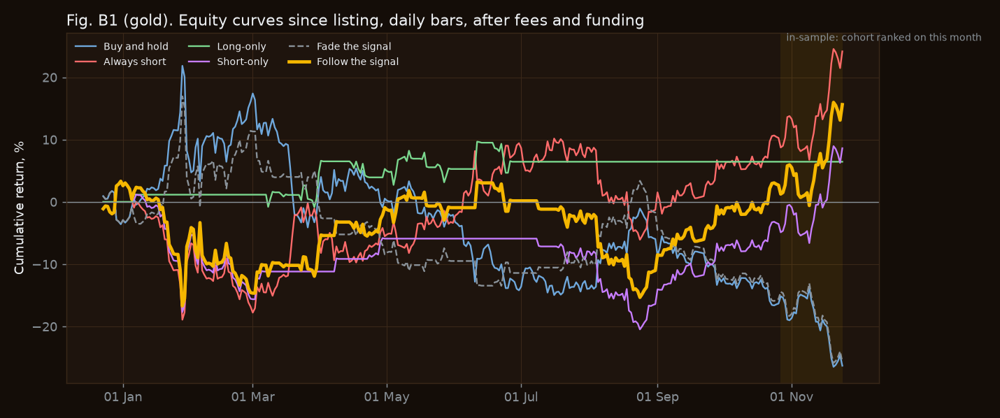
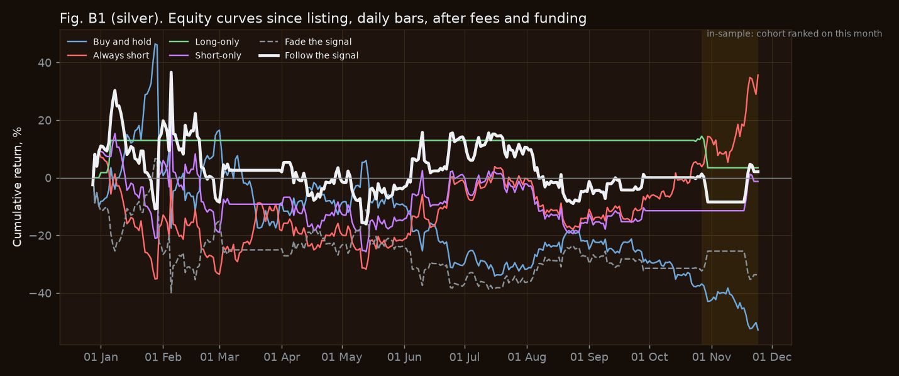
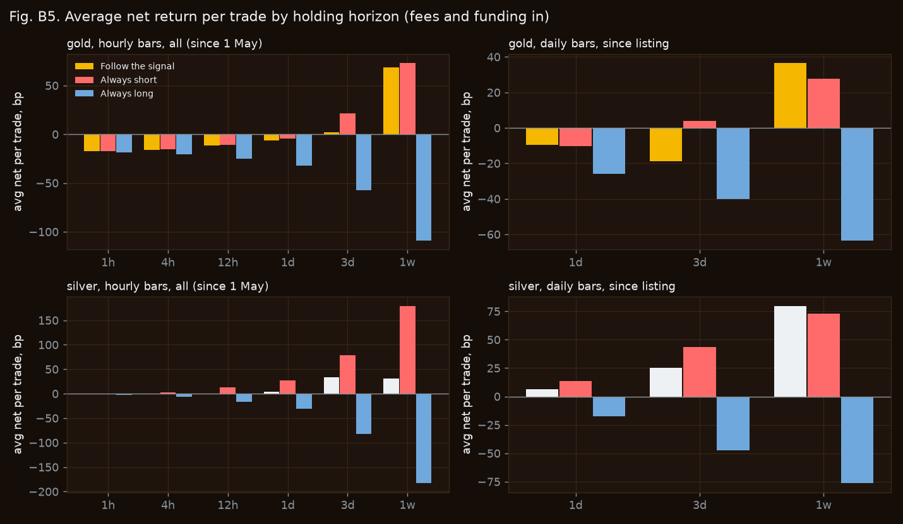
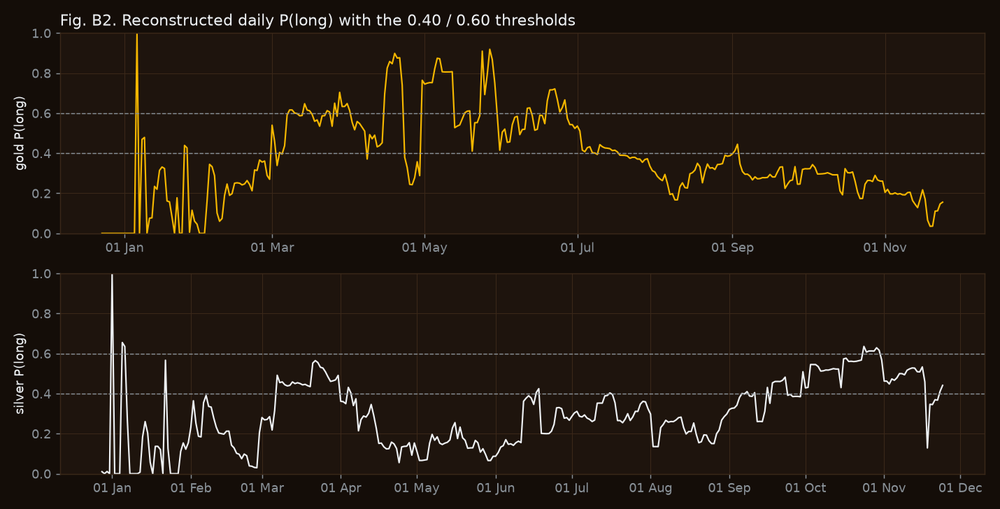
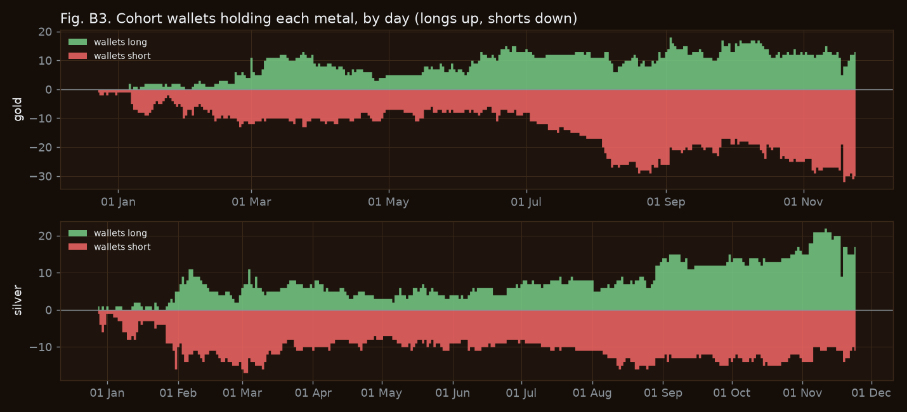
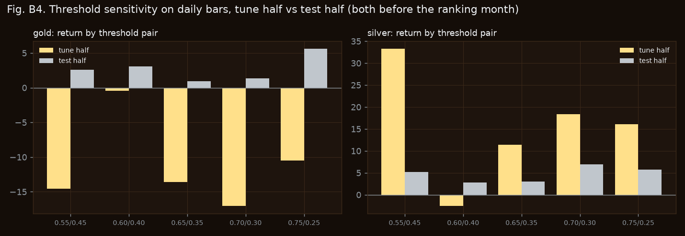

# Backtest: would following the cohort have paid?

> Not financial advice. A reconstruction with known biases, written down below. Bag holders, read the limits first.

**Short answer.** Gold: signal +15.6% vs hold -26.3% and always short +24.2% since listing; Silver: signal +2.1% vs hold -52.8% and always short +35.6% since listing. The out-of-sample rows are the ones to read.

## Question and rules

Would trading the live call (LONG at P(long) of 0.60 or more, SHORT at 0.40 or less, flat otherwise) have made money on `xyz:GOLD` and `xyz:SILVER` after fees and funding, and does it beat buy-and-hold or always-short? Rules, fixed before any metal result was looked at (all inherited from the BTC project):

- **Cohort and weights.** Exactly the live ones: today's top 500 wallets, today's month PnL and equity, the live weight formula.
- **Information.** For each UTC day D, P(long) is computed from each wallet's position on day D-1. Older history exists only as daily figures, so the backfill refreshes at 00:00 UTC; the live site refreshes every 30 minutes.
- **Trading.** One unit of notional, no leverage, no slippage. Taker fee on every change of position (`xyz:GOLD` 0.09%, `xyz:SILVER` 0.009% in growth mode) and every hour of funding paid or received.
- **Bars.** Daily bars since listing (longest), and hourly bars over the latest 5,000 hourly candles (the API keeps no more). The signal is the same on both; hourly bars only change how returns and drawdowns are measured within the day.
- **Sample marking.** The cohort was ranked on the last 30 days, so those days are **in-sample**. Every window that ends before them is marked out-of-sample.
- **Regimes.** Each bar is labelled by its trailing 7-day log return divided by its own volatility over the same days: up above +0.5, down below -0.5, sideways otherwise. Past prices only.
- **Threshold grid.** Five symmetric pairs from 0.55 / 0.45 to 0.75 / 0.25, chosen in advance. The out-of-sample span is split in time order: the first half tunes, the second half tests.

## How far each input reaches

| Input | From (UTC) | To (UTC) | Notes |
| :--- | :--- | :--- | :--- |
| `xyz:GOLD` 1h candles | 2026-05-01T02:00Z | 2026-11-25T13:00Z | 5004 candles; the API keeps only the latest 5,000 |
| `xyz:GOLD` 1d candles | 2025-12-22T00:00Z | 2026-11-25T00:00Z | 339 candles, since listing |
| `xyz:GOLD` funding | 2025-12-22T15:00Z | 2026-11-25T13:00Z | 8111 hourly rates |
| `xyz:SILVER` 1h candles | 2026-05-01T03:00Z | 2026-11-25T13:00Z | 5003 candles; the API keeps only the latest 5,000 |
| `xyz:SILVER` 1d candles | 2025-12-26T00:00Z | 2026-11-25T00:00Z | 335 candles, since listing |
| `xyz:SILVER` funding | 2025-12-26T01:00Z | 2026-11-25T13:00Z | 8029 hourly rates |
| `PAXG` 1h candles | 2026-05-01T02:00Z | 2026-11-25T13:00Z | 5004 candles; the API keeps only the latest 5,000 |
| `PAXG` 1d candles | 2025-03-27T00:00Z | 2026-11-25T00:00Z | 609 candles, since listing |
| `PAXG` funding | 2025-04-06T16:00Z | 2026-11-25T13:00Z | 14350 hourly rates |
| Wallet metal positions | 2025-12-21T15:00Z | 2026-11-25T13:15Z | `userFunding`: 500 wallets read in full. Daily figures to 2026-11-16, then one funding hour (12:00 UTC) per day. |
| Wallets assumed flat | – | – | 0 wallets with no xyz account and no metal position today (not read) |
| Cohort, month PnL, equity | 2026-11-25T13:10:07Z | same | today only, applied to every past day |
| Wallet fills | – | – | not used: `userFillsByTime` keeps the 10,000 latest fills, two to four days for the busiest wallets |

Coverage: all 500 cohort wallets were read in full (zero wallets missing or assumed flat). A wallet that never held a metal simply never votes.

## Gold (`xyz:GOLD`)

Wallets voting per day: median 21, range 1 to 43. Signal mix since listing: long 16%, short 60%, flat 24%.

**Windows**

| Window | Span | Bars | Sample | Metal | Signal | Hold | Always short | Signal Sharpe-like |
| :--- | :--- | ---: | :--- | ---: | ---: | ---: | ---: | ---: |
| Since listing (daily bars) | 23 Dec 2025 to 25 Nov 2026 | 337 | last 30 days in-sample | -20.4% | **+15.6%** | -26.3% | +24.2% | 0.71 |
| Since listing, before ranking month (daily, out-of-sample) | 23 Dec 2025 to 27 Oct 2026 | 308 | out-of-sample | -10.1% | **+2.7%** | -16.3% | +10.3% | 0.25 |
| Hourly max (all 1h candles) | 01 May 2026 to 25 Nov 2026 | 5003 | last 30 days in-sample | -23.8% | **+18.3%** | -27.2% | +33.0% | 1.56 |
| Hourly, before ranking month (out-of-sample) | 01 May 2026 to 26 Oct 2026 | 4284 | out-of-sample | -13.6% | **+4.3%** | -17.0% | +17.3% | 0.55 |
| Last 90 days (hourly) | 27 Aug 2026 to 25 Nov 2026 | 2160 | last 30 days in-sample | -23.1% | **+34.8%** | -24.5% | +30.5% | 5.43 |
| Last 30 days (hourly, in-sample) | 26 Oct 2026 to 25 Nov 2026 | 720 | in-sample | -12.3% | **+13.9%** | -12.9% | +13.9% | 5.99 |

**All strategies, out-of-sample (daily bars)**

| Strategy | Return | Max DD | Sharpe-like | Hit rate | Avg per bar in market | In market | Trades | Fees | Funding |
| :--- | ---: | ---: | ---: | ---: | ---: | ---: | ---: | ---: | ---: |
| **Follow the signal** | **+2.7%** | -19.4% | 0.25 | 49.6% | 3.22 bp | 74% | 41 | -4.05% | +3.51% |
| Long-only | +6.4% | -4.7% | 0.70 | 49.1% | 14.33 bp | 18% | 24 | -2.16% | -1.08% |
| Short-only | -3.5% | -23.0% | -0.05 | 49.7% | -0.10 bp | 56% | 21 | -1.89% | +4.58% |
| Fade the signal | -15.6% | -28.1% | -0.60 | 50.4% | -5.35 bp | 74% | 41 | -4.05% | -3.51% |
| Buy and hold | -16.3% | -31.6% | -0.54 | 47.7% | -4.50 bp | 100% | 1 | -0.09% | -7.04% |
| Always short | +10.3% | -21.5% | 0.53 | 52.3% | 4.44 bp | 100% | 1 | -0.09% | +7.04% |

**All strategies, since listing (daily bars)**

| Strategy | Return | Max DD | Sharpe-like | Hit rate | Avg per bar in market | In market | Trades | Fees | Funding |
| :--- | ---: | ---: | ---: | ---: | ---: | ---: | ---: | ---: | ---: |
| **Follow the signal** | **+15.6%** | -19.4% | 0.71 | 51.4% | 7.63 bp | 76% | 41 | -4.05% | +4.11% |
| Long-only | +6.4% | -4.7% | 0.67 | 49.1% | 14.33 bp | 16% | 24 | -2.16% | -1.08% |
| Short-only | +8.6% | -23.0% | 0.48 | 52.0% | 5.99 bp | 60% | 21 | -1.89% | +5.19% |
| Fade the signal | -25.7% | -36.6% | -1.02 | 48.6% | -9.52 bp | 76% | 41 | -4.05% | -4.11% |
| Buy and hold | -26.3% | -39.7% | -0.92 | 46.6% | -7.76 bp | 100% | 1 | -0.09% | -7.64% |
| Always short | +24.2% | -21.5% | 0.92 | 53.4% | 7.70 bp | 100% | 1 | -0.09% | +7.64% |

**Regimes, since listing**

| Regime | Days | Metal | Signal | Signal hit rate | Long / short calls | Hold | Always short |
| :--- | ---: | ---: | ---: | ---: | ---: | ---: | ---: |
| up | 92 | -0.9% | -0.1% | 53% | 10% / 68% | -3.3% | -0.1% |
| down | 126 | -23.7% | +13.4% | 55% | 22% / 54% | -25.8% | +30.4% |
| sideways | 113 | +3.5% | +3.8% | 47% | 16% / 58% | +1.2% | -3.0% |

**Threshold grid (daily bars)**

Tune 23 Dec 2025 to 26 May 2026, test 26 May 2026 to 27 Oct 2026. Best on tune: 0.60 / 0.40.

| Long / short at | Tune return | Tune Sharpe-like | Test return | Test Sharpe-like | Full return | In market |
| :--- | ---: | ---: | ---: | ---: | ---: | ---: |
| 0.55 / 0.45 | -14.5% | -0.93 | +2.6% | 0.39 | -1.2% | 90% |
| 0.60 / 0.40 (live) ★ | -0.4% | 0.13 | +3.0% | 0.44 | +15.6% | 76% |
| 0.65 / 0.35 | -13.6% | -1.01 | +0.9% | 0.21 | -1.7% | 64% |
| 0.70 / 0.30 | -17.0% | -1.49 | +1.3% | 0.29 | -5.4% | 50% |
| 0.75 / 0.25 | -10.5% | -0.89 | +5.6% | 1.39 | +3.1% | 34% |

## Silver (`xyz:SILVER`)

Wallets voting per day: median 17, range 1 to 33. Signal mix since listing: long 3%, short 71%, flat 26%.

**Windows**

| Window | Span | Bars | Sample | Metal | Signal | Hold | Always short | Signal Sharpe-like |
| :--- | :--- | ---: | :--- | ---: | ---: | ---: | ---: | ---: |
| Since listing (daily bars) | 28 Dec 2025 to 25 Nov 2026 | 332 | last 30 days in-sample | -48.3% | **+2.1%** | -52.8% | +35.6% | 0.34 |
| Since listing, before ranking month (daily, out-of-sample) | 28 Dec 2025 to 27 Oct 2026 | 303 | out-of-sample | -31.9% | **+0.2%** | -37.5% | +4.9% | 0.32 |
| Hourly max (all 1h candles) | 01 May 2026 to 25 Nov 2026 | 5002 | last 30 days in-sample | -46.0% | **+3.3%** | -48.8% | +72.9% | 0.34 |
| Hourly, before ranking month (out-of-sample) | 01 May 2026 to 26 Oct 2026 | 4283 | out-of-sample | -28.2% | **+0.1%** | -31.3% | +31.9% | 0.21 |
| Last 90 days (hourly) | 27 Aug 2026 to 25 Nov 2026 | 2160 | last 30 days in-sample | -41.1% | **+9.8%** | -42.2% | +65.6% | 1.54 |
| Last 30 days (hourly, in-sample) | 26 Oct 2026 to 25 Nov 2026 | 720 | in-sample | -25.7% | **+1.9%** | -26.3% | +32.7% | 0.92 |

**All strategies, out-of-sample (daily bars)**

| Strategy | Return | Max DD | Sharpe-like | Hit rate | Avg per bar in market | In market | Trades | Fees | Funding |
| :--- | ---: | ---: | ---: | ---: | ---: | ---: | ---: | ---: | ---: |
| **Follow the signal** | **+0.2%** | -38.5% | 0.32 | 43.7% | 7.46 bp | 79% | 27 | -0.28% | +6.71% |
| Long-only | +13.2% | -0.3% | 1.61 | 66.7% | 213.31 bp | 2% | 5 | -0.05% | -0.24% |
| Short-only | -11.5% | -38.5% | 0.09 | 43.1% | 2.16 bp | 77% | 26 | -0.23% | +6.95% |
| Fade the signal | -31.6% | -43.6% | -0.33 | 55.9% | -7.62 bp | 79% | 27 | -0.28% | -6.71% |
| Buy and hold | -37.5% | -57.6% | -0.42 | 53.5% | -8.18 bp | 100% | 1 | -0.01% | -8.39% |
| Always short | +4.9% | -40.6% | 0.42 | 46.2% | 8.17 bp | 100% | 1 | -0.01% | +8.39% |

**All strategies, since listing (daily bars)**

| Strategy | Return | Max DD | Sharpe-like | Hit rate | Avg per bar in market | In market | Trades | Fees | Funding |
| :--- | ---: | ---: | ---: | ---: | ---: | ---: | ---: | ---: | ---: |
| **Follow the signal** | **+2.1%** | -38.5% | 0.34 | 43.7% | 8.18 bp | 74% | 30 | -0.31% | +6.71% |
| Long-only | +3.4% | -9.6% | 0.38 | 50.0% | 39.91 bp | 3% | 6 | -0.05% | -0.41% |
| Short-only | -1.3% | -38.5% | 0.28 | 43.5% | 6.85 bp | 71% | 28 | -0.25% | +7.11% |
| Fade the signal | -33.7% | -43.6% | -0.35 | 55.9% | -8.33 bp | 74% | 30 | -0.31% | -6.71% |
| Buy and hold | -52.8% | -67.8% | -0.82 | 52.7% | -15.56 bp | 100% | 1 | -0.01% | -9.06% |
| Always short | +35.6% | -40.6% | 0.82 | 47.0% | 15.55 bp | 100% | 1 | -0.01% | +9.06% |

**Regimes, since listing**

| Regime | Days | Metal | Signal | Signal hit rate | Long / short calls | Hold | Always short |
| :--- | ---: | ---: | ---: | ---: | ---: | ---: | ---: |
| up | 107 | -10.8% | -6.3% | 42% | 1% / 84% | -13.5% | -3.1% |
| down | 135 | -44.4% | +19.0% | 48% | 6% / 62% | -46.5% | +53.7% |
| sideways | 85 | +13.3% | -17.5% | 39% | 0% / 69% | +11.0% | -15.0% |

**Threshold grid (daily bars)**

Tune 28 Dec 2025 to 28 May 2026, test 28 May 2026 to 27 Oct 2026. Best on tune: 0.55 / 0.45.

| Long / short at | Tune return | Tune Sharpe-like | Test return | Test Sharpe-like | Full return | In market |
| :--- | ---: | ---: | ---: | ---: | ---: | ---: |
| 0.55 / 0.45 ★ | +33.2% | 1.21 | +5.2% | 0.50 | +49.6% | 85% |
| 0.60 / 0.40 (live) | -2.5% | 0.33 | +2.8% | 0.37 | +2.1% | 74% |
| 0.65 / 0.35 | +11.4% | 0.70 | +3.0% | 0.38 | +31.1% | 62% |
| 0.70 / 0.30 | +18.4% | 0.88 | +6.9% | 0.64 | +31.8% | 55% |
| 0.75 / 0.25 | +16.1% | 0.82 | +5.8% | 0.61 | +28.0% | 41% |

## Holding horizons: is it a short-term or a long-term signal?

Method: every N hours (aligned to the UTC clock; weekly entries to the Unix week, so Thursday 00:00 UTC) the latest call is read and traded for exactly N hours, then closed. One unit of notional, round-trip fee (0.18% gold, 0.018% silver) and funding while held. A trade must finish inside the window. "Hit rate" is the share of trades with the right direction before costs. The always-short and always-long columns use the same schedule, so they show what the horizon itself pays. Hourly candles exist only from 1 May 2026, so 1h, 4h and 12h can only be measured there; daily bars reach back to listing but cannot see anything shorter than a day. The call itself refreshes once a day in this backtest (positions of the day before), so a 1h trade re-reads the same call 24 times a day: that is a test of timing inside the day, not of a faster signal.

### Gold

**Hourly bars, all (1 May to now)**

| Horizon | Trades | Hit rate | Avg gross | Avg net | Always-short avg net | Always-long avg net | Total return | Max DD | Long / short calls | Verdict |
| :--- | ---: | ---: | ---: | ---: | ---: | ---: | ---: | ---: | ---: | :--- |
| 1h | 3851 | 50% | +0.5 bp | **-17.5 bp** | -17.4 bp | -18.6 bp | -99.9% | -99.9% | 742 / 3109 | loses money |
| 4h | 962 | 52% | +1.9 bp | **-15.9 bp** | -15.5 bp | -20.5 bp | -78.6% | -79.3% | 185 / 777 | loses money |
| 12h | 320 | 55% | +6.0 bp | **-11.4 bp** | -10.8 bp | -25.2 bp | -31.4% | -39.7% | 61 / 259 | loses money |
| 1d | 159 | 57% | +10.4 bp | **-6.4 bp** | -4.1 bp | -31.9 bp | -10.5% | -24.9% | 30 / 129 | loses money |
| 3d | 53 | 53% | +16.1 bp | **+2.0 bp** | +21.2 bp | -57.2 bp | +0.4% | -20.5% | 9 / 44 | makes money, a baseline did better |
| 1w | 21 | 57% | +78.0 bp | **+68.4 bp** | +73.1 bp | -109.1 bp | +14.2% | -14.9% | 4 / 17 | makes money, a baseline did better |

**Hourly, before ranking month (out-of-sample)**

| Horizon | Trades | Hit rate | Avg gross | Avg net | Always-short avg net | Always-long avg net | Total return | Max DD | Long / short calls | Verdict |
| :--- | ---: | ---: | ---: | ---: | ---: | ---: | ---: | ---: | ---: | :--- |
| 1h | 3132 | 50% | +0.2 bp | **-17.8 bp** | -17.6 bp | -18.4 bp | -99.6% | -99.6% | 742 / 2390 | loses money |
| 4h | 782 | 51% | +0.6 bp | **-17.3 bp** | -16.4 bp | -19.6 bp | -74.3% | -74.3% | 185 / 597 | loses money |
| 12h | 260 | 55% | +2.1 bp | **-15.4 bp** | -13.6 bp | -22.4 bp | -33.6% | -35.6% | 61 / 199 | loses money |
| 1d | 129 | 55% | +4.0 bp | **-13.1 bp** | -8.5 bp | -27.5 bp | -16.2% | -24.9% | 30 / 99 | loses money |
| 3d | 43 | 53% | -0.6 bp | **-15.3 bp** | +11.7 bp | -47.7 bp | -7.1% | -20.5% | 9 / 34 | loses money |
| 1w | 17 | 53% | +40.3 bp | **+29.0 bp** | +46.0 bp | -82.0 bp | +4.2% | -14.9% | 4 / 13 | makes money, a baseline did better |

**Hourly, last 90 days**

| Horizon | Trades | Hit rate | Avg gross | Avg net | Always-short avg net | Always-long avg net | Total return | Max DD | Long / short calls | Verdict |
| :--- | ---: | ---: | ---: | ---: | ---: | ---: | ---: | ---: | ---: | :--- |
| 1h | 2112 | 51% | +1.4 bp | **-16.5 bp** | -16.7 bp | -19.3 bp | -97.0% | -97.0% | 0 / 2112 | loses money |
| 4h | 527 | 55% | +5.8 bp | **-11.9 bp** | -12.6 bp | -23.4 bp | -46.9% | -49.7% | 0 / 527 | loses money |
| 12h | 175 | 61% | +17.2 bp | **+0.2 bp** | -2.1 bp | -33.9 bp | -0.3% | -15.9% | 0 / 175 | beats both baselines |
| 1d | 87 | 66% | +32.6 bp | **+16.6 bp** | +12.0 bp | -48.0 bp | +15.0% | -8.1% | 0 / 87 | beats both baselines |
| 3d | 29 | 66% | +68.2 bp | **+56.4 bp** | +56.4 bp | -92.4 bp | +17.3% | -7.1% | 0 / 29 | makes money, a baseline did better |
| 1w | 10 | 60% | +158.0 bp | **+154.6 bp** | +137.9 bp | -173.9 bp | +16.0% | -6.6% | 0 / 10 | beats both baselines |

**Hourly, last 30 days (in-sample)**

| Horizon | Trades | Hit rate | Avg gross | Avg net | Always-short avg net | Always-long avg net | Total return | Max DD | Long / short calls | Verdict |
| :--- | ---: | ---: | ---: | ---: | ---: | ---: | ---: | ---: | ---: | :--- |
| 1h | 720 | 51% | +1.8 bp | **-16.1 bp** | -16.1 bp | -19.9 bp | -68.8% | -68.9% | 0 / 720 | loses money |
| 4h | 179 | 57% | +7.6 bp | **-10.0 bp** | -10.0 bp | -26.0 bp | -16.6% | -19.4% | 0 / 179 | loses money |
| 12h | 59 | 58% | +22.7 bp | **+5.8 bp** | +5.8 bp | -41.8 bp | +3.2% | -9.7% | 0 / 59 | makes money, a baseline did better |
| 1d | 29 | 66% | +40.2 bp | **+24.3 bp** | +24.3 bp | -60.3 bp | +7.1% | -8.1% | 0 / 29 | makes money, a baseline did better |
| 3d | 9 | 56% | +118.1 bp | **+106.4 bp** | +106.4 bp | -142.4 bp | +10.2% | -7.1% | 0 / 9 | makes money, a baseline did better |
| 1w | 3 | 67% | +261.4 bp | **+258.1 bp** | +258.1 bp | -294.1 bp | +7.9% | -6.6% | 0 / 3 | makes money, a baseline did better |

**Daily bars, since listing**

| Horizon | Trades | Hit rate | Avg gross | Avg net | Always-short avg net | Always-long avg net | Total return | Max DD | Long / short calls | Verdict |
| :--- | ---: | ---: | ---: | ---: | ---: | ---: | ---: | ---: | ---: | :--- |
| 1d | 257 | 51% | +7.0 bp | **-9.4 bp** | -10.3 bp | -25.7 bp | -24.2% | -36.0% | 55 / 202 | loses money |
| 3d | 88 | 47% | -6.0 bp | **-18.8 bp** | +4.0 bp | -40.0 bp | -18.2% | -35.1% | 19 / 69 | loses money |
| 1w | 35 | 57% | +43.5 bp | **+36.5 bp** | +27.5 bp | -63.5 bp | +9.6% | -19.7% | 7 / 28 | beats both baselines |

**Daily, since listing to before ranking month (out-of-sample)**

| Horizon | Trades | Hit rate | Avg gross | Avg net | Always-short avg net | Always-long avg net | Total return | Max DD | Long / short calls | Verdict |
| :--- | ---: | ---: | ---: | ---: | ---: | ---: | ---: | ---: | ---: | :--- |
| 1d | 228 | 50% | +2.7 bp | **-13.7 bp** | -13.5 bp | -22.5 bp | -29.1% | -36.0% | 55 / 173 | loses money |
| 3d | 78 | 46% | -18.0 bp | **-31.0 bp** | -3.1 bp | -32.9 bp | -24.2% | -35.1% | 19 / 59 | loses money |
| 1w | 31 | 55% | +18.4 bp | **+10.8 bp** | +8.2 bp | -44.2 bp | +0.2% | -19.7% | 7 / 24 | beats both baselines |

### Silver

**Hourly bars, all (1 May to now)**

| Horizon | Trades | Hit rate | Avg gross | Avg net | Always-short avg net | Always-long avg net | Total return | Max DD | Long / short calls | Verdict |
| :--- | ---: | ---: | ---: | ---: | ---: | ---: | ---: | ---: | ---: | :--- |
| 1h | 3621 | 49% | +0.1 bp | **-1.6 bp** | -0.6 bp | -3.0 bp | -46.1% | -51.5% | 168 / 3453 | loses money |
| 4h | 905 | 50% | +0.5 bp | **-0.9 bp** | +3.2 bp | -6.8 bp | -11.9% | -30.7% | 42 / 863 | loses money |
| 12h | 301 | 52% | +1.2 bp | **+0.6 bp** | +13.0 bp | -16.6 bp | -2.6% | -26.6% | 14 / 287 | makes money, a baseline did better |
| 1d | 150 | 48% | +3.6 bp | **+4.2 bp** | +26.8 bp | -30.4 bp | +2.4% | -25.7% | 7 / 143 | makes money, a baseline did better |
| 3d | 50 | 48% | +28.7 bp | **+33.9 bp** | +78.5 bp | -82.1 bp | +12.9% | -23.1% | 2 / 48 | makes money, a baseline did better |
| 1w | 20 | 50% | +18.3 bp | **+31.4 bp** | +179.6 bp | -183.2 bp | +3.0% | -24.9% | 1 / 19 | makes money, a baseline did better |

**Hourly, before ranking month (out-of-sample)**

| Horizon | Trades | Hit rate | Avg gross | Avg net | Always-short avg net | Always-long avg net | Total return | Max DD | Long / short calls | Verdict |
| :--- | ---: | ---: | ---: | ---: | ---: | ---: | ---: | ---: | ---: | :--- |
| 1h | 3395 | 50% | +0.0 bp | **-1.7 bp** | -1.0 bp | -2.6 bp | -45.6% | -47.3% | 62 / 3333 | loses money |
| 4h | 848 | 51% | +0.3 bp | **-1.1 bp** | +1.1 bp | -4.7 bp | -12.5% | -29.8% | 15 / 833 | loses money |
| 12h | 282 | 52% | +0.5 bp | **+0.0 bp** | +6.8 bp | -10.4 bp | -3.9% | -26.6% | 5 / 277 | makes money, a baseline did better |
| 1d | 140 | 49% | +2.2 bp | **+3.0 bp** | +16.4 bp | -20.0 bp | +0.7% | -25.7% | 2 / 138 | makes money, a baseline did better |
| 3d | 46 | 48% | +29.6 bp | **+35.5 bp** | +57.3 bp | -60.9 bp | +12.3% | -23.1% | 0 / 46 | makes money, a baseline did better |
| 1w | 19 | 53% | +35.4 bp | **+50.7 bp** | +113.9 bp | -117.5 bp | +6.5% | -24.9% | 0 / 19 | makes money, a baseline did better |

**Hourly, last 90 days**

| Horizon | Trades | Hit rate | Avg gross | Avg net | Always-short avg net | Always-long avg net | Total return | Max DD | Long / short calls | Verdict |
| :--- | ---: | ---: | ---: | ---: | ---: | ---: | ---: | ---: | ---: | :--- |
| 1h | 851 | 49% | +1.2 bp | **-0.6 bp** | +0.6 bp | -4.2 bp | -5.7% | -17.7% | 168 / 683 | loses money |
| 4h | 212 | 53% | +5.7 bp | **+4.1 bp** | +8.7 bp | -12.3 bp | +8.1% | -11.1% | 42 / 170 | makes money, a baseline did better |
| 12h | 70 | 53% | +16.5 bp | **+15.3 bp** | +29.4 bp | -33.0 bp | +10.4% | -10.6% | 14 / 56 | makes money, a baseline did better |
| 1d | 35 | 49% | +32.8 bp | **+32.2 bp** | +56.3 bp | -59.9 bp | +11.1% | -10.5% | 7 / 28 | makes money, a baseline did better |
| 3d | 12 | 50% | +83.1 bp | **+85.0 bp** | +143.9 bp | -147.5 bp | +10.0% | -10.2% | 2 / 10 | makes money, a baseline did better |
| 1w | 5 | 40% | +87.0 bp | **+92.9 bp** | +326.4 bp | -330.0 bp | +4.1% | -10.2% | 1 / 4 | makes money, a baseline did better |

**Hourly, last 30 days (in-sample)**

| Horizon | Trades | Hit rate | Avg gross | Avg net | Always-short avg net | Always-long avg net | Total return | Max DD | Long / short calls | Verdict |
| :--- | ---: | ---: | ---: | ---: | ---: | ---: | ---: | ---: | ---: | :--- |
| 1h | 227 | 44% | +1.0 bp | **-0.8 bp** | +2.3 bp | -5.9 bp | -2.1% | -11.4% | 107 / 120 | loses money |
| 4h | 56 | 39% | +3.7 bp | **+1.9 bp** | +15.7 bp | -19.3 bp | +0.6% | -10.5% | 26 / 30 | makes money, a baseline did better |
| 12h | 18 | 50% | +13.8 bp | **+11.9 bp** | +50.5 bp | -54.1 bp | +1.8% | -10.3% | 8 / 10 | makes money, a baseline did better |
| 1d | 9 | 44% | +27.2 bp | **+25.3 bp** | +90.8 bp | -94.4 bp | +1.9% | -10.3% | 4 / 5 | makes money, a baseline did better |
| 3d | 3 | 33% | -32.1 bp | **-32.4 bp** | +242.5 bp | -246.1 bp | -1.1% | -10.1% | 1 / 2 | loses money |
| 1w | 1 | 0% | -307.3 bp | **-334.9 bp** | +555.5 bp | -559.1 bp | -3.3% | -9.9% | 1 / 0 | loses money |

**Daily bars, since listing**

| Horizon | Trades | Hit rate | Avg gross | Avg net | Always-short avg net | Always-long avg net | Total return | Max DD | Long / short calls | Verdict |
| :--- | ---: | ---: | ---: | ---: | ---: | ---: | ---: | ---: | ---: | :--- |
| 1d | 247 | 44% | +5.5 bp | **+6.5 bp** | +13.8 bp | -17.4 bp | -2.0% | -39.3% | 10 / 237 | makes money, a baseline did better |
| 3d | 82 | 48% | +19.2 bp | **+25.1 bp** | +43.7 bp | -47.3 bp | +0.5% | -37.8% | 3 / 79 | makes money, a baseline did better |
| 1w | 34 | 56% | +66.5 bp | **+79.8 bp** | +72.9 bp | -76.5 bp | +4.8% | -37.8% | 2 / 32 | beats both baselines |

**Daily, since listing to before ranking month (out-of-sample)**

| Horizon | Trades | Hit rate | Avg gross | Avg net | Always-short avg net | Always-long avg net | Total return | Max DD | Long / short calls | Verdict |
| :--- | ---: | ---: | ---: | ---: | ---: | ---: | ---: | ---: | ---: | :--- |
| 1d | 238 | 44% | +4.7 bp | **+5.7 bp** | +6.4 bp | -10.0 bp | -3.7% | -39.3% | 6 / 232 | makes money, a baseline did better |
| 3d | 78 | 47% | +19.2 bp | **+25.6 bp** | +27.9 bp | -31.5 bp | +0.2% | -37.8% | 1 / 77 | makes money, a baseline did better |
| 1w | 33 | 58% | +77.8 bp | **+92.4 bp** | +25.2 bp | -28.8 bp | +8.4% | -37.8% | 1 / 32 | beats both baselines |

**Reading it.** Gold, hourly bars: average net per trade is negative at 1h, 4h, 12h, 1d; positive at 3d, 1w; Gold, daily bars: average net per trade is negative at 1d, 3d; positive at 1w. Silver, hourly bars: average net per trade is negative at 1h, 4h; positive at 12h, 1d, 3d, 1w; Silver, daily bars: average net per trade is negative at no horizon; positive at 1d, 3d, 1w. Where the signal's average net per trade is below zero the horizon loses money; where always-short on the same schedule does better, the call added nothing in a falling market. Net includes funding, which is income for shorts when funding is positive, so it can exceed gross. Average per trade and compounded total return can disagree in sign when a few large losers sit among many small winners.

## Signal and participation

## Verdict

- **Gold, out-of-sample (23 Dec 2025 to 27 Oct 2026):** the signal made +2.7% (Sharpe-like 0.25, max drawdown -19.4%) while gold moved -10.1%. Buy and hold made -16.3%, always short +10.3%. Against the better baseline (always short) that is -7.6%: no edge over simply picking a side.
- **Gold, why:** the cohort was short 60% of days, long 16%, flat 24%. In a falling market a mostly-short reading earns most of what always-short earns; the question is whether its long and flat days helped. Short-only legs made -3.5%, long-only legs +6.4%, and fading the signal -15.6%.
- **Gold, thresholds:** the best of five pairs on the tune half was 0.60 / 0.40; the live pair was itself the best on the tune half, so nothing was gained by moving it.
- **Gold, horizons:** after round-trip fees (18.0 bp) and funding, the signal loses money per trade at 1h, 4h, 12h, 1d on hourly bars (1 May to now) and at 1d, 3d on daily bars since listing. Hit rates sit near 50% at the short horizons, so the gross edge is a few basis points at best. It beats both naive holds on the same schedule only at: 1d (-9.4 bp vs -10.3 bp, 257 trades); 1w (+36.5 bp vs +27.5 bp, 35 trades). Those cells are small samples.
- **Silver, out-of-sample (28 Dec 2025 to 27 Oct 2026):** the signal made +0.2% (Sharpe-like 0.32, max drawdown -38.5%) while silver moved -31.9%. Buy and hold made -37.5%, always short +4.9%. Against the better baseline (always short) that is -4.7%: no edge over simply picking a side.
- **Silver, why:** the cohort was short 71% of days, long 3%, flat 26%. In a falling market a mostly-short reading earns most of what always-short earns; the question is whether its long and flat days helped. Short-only legs made -11.5%, long-only legs +13.2%, and fading the signal -31.6%.
- **Silver, thresholds:** the best of five pairs on the tune half was 0.55 / 0.45; it made +5.2% on the test half against +2.8% for the live 0.60 / 0.40. The tuned pair held up out of sample, but the gap sits inside the noise of a few dozen trades; the live thresholds stay.
- **Silver, horizons:** after round-trip fees (1.8 bp) and funding, the signal loses money per trade at 1h, 4h on hourly bars (1 May to now) and at no horizon on daily bars since listing. Hit rates sit near 50% at the short horizons, so the gross edge is a few basis points at best. It beats both naive holds on the same schedule only at: 1w (+79.8 bp vs +72.9 bp, 34 trades). Those cells are small samples.
- **Biases that flatter these numbers:** the cohort, its month PnL and its equity are today's, applied to every past day (survivorship). Wallets that blew up before today never vote. The last 30 days are in-sample by construction, which is why the out-of-sample cut stops before them.
- **Biases that hurt them:** the backfill can only refresh once a day on yesterday's average position, while the live site refreshes every 30 minutes. Positions opened and closed between two funding hours never show up.
- **Verdict:** treat the call as a positioning read, not a trading system. The honest test is the forward one: stored live snapshots, same rules, no hindsight (v2, P1).

## Files

- `data/inputs/` compact inputs (market history, wallets, daily position paths, reach). Committed, so the analysis re-runs offline.
- `data/daily_gold.csv`, `data/daily_silver.csv`: one row per day with P(long), voters, signal, regime, funding and returns.
- `data/hourly_gold.csv`, `data/hourly_silver.csv`: the same signal on hourly bars.
- `data/strategies.csv`, `data/regimes.csv`, `data/threshold_grid.csv`, `data/summary.json`.
- `figures/*.png` (including `horizons.png`).
- `scripts/`: `fetch.py`, `fetch_positions.py`, `prepare.py`, `analyze.py`, `plot.py`, `report.py`, in that order.
